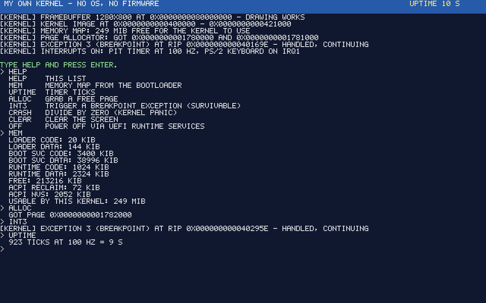

# UEFI Lab — writing your own firmware (UEFI → ring -2 SMM), on Windows 11

You develop on Windows 11. The firmware code runs in **QEMU**, an emulator,
on top of **OVMF**, open-source UEFI firmware. Nothing here touches your PC's
real firmware, Secure Boot or BitLocker, and nothing can brick it.

> These scripts only run if you run them. Nothing in this repo runs on its own.

| Phase | What | Folder |
|---|---|---|
| 0 | Mental model: ring 3 → 0 → -1 (hypervisor) → -2 (SMM) → -3 (ME/PSP) | — |
| 1 | Toolchain: LLVM/Clang + lld-link, QEMU + OVMF | `setup.cmd` |
| 2 | First UEFI app → `BOOTX64.EFI` | [`phase2-hello/`](phase2-hello) |
| 3 | UEFI driver + protocols, boot vs. runtime services, OS handoff | [`phase3-driver/`](phase3-driver) |
| 4 | Ring -2: our own SMI handler in SMRAM, in our own firmware build | [`phase4-smm/`](phase4-smm) |
| 5 | Our own bootloader + our own kernel: page tables, interrupts, framebuffer, a shell | [`phase5-kernel/`](phase5-kernel) |
| 6 | Ring -2 guards the flash: only SMM may write firmware storage, and our handler owns a variable ring 0 can't change | [`phase6-smm-flash/`](phase6-smm-flash) |
| 7 | The same handler in **Standalone MM**, the newer, isolated ring -2 architecture, compared with Traditional MM | [`phase7-standalone-mm/`](phase7-standalone-mm) |
| 8 | Debugging ring -2: breakpoints, source stepping and memory reads **inside SMM** with LLDB/GDB | [`phase8-smm-gdb/`](phase8-smm-gdb) |

## Quick start (Windows 11)

Open the `uefi-lab` folder in File Explorer or a terminal, then:

| Step | Run | What it does |
|---|---|---|
| 1 | `setup.cmd` | Installs LLVM and QEMU with winget. Each one shows a UAC prompt. QEMU includes the OVMF firmware. |
| 2 | `selftest.cmd` | Builds phases 2 to 8 and boots each one in QEMU with no window. Prints `PASS`/`FAIL` (takes about a minute). |
| 3 | `phase2-hello\run.cmd` | Boots phase 2 in a QEMU window. |
|   | `phase2-hello\run.cmd -Headless` | Same, but the firmware console shows in your terminal. Quit with **Ctrl+A** then **X**. |

The `.cmd` files are thin wrappers around the `.ps1` scripts. They exist
because Windows 11 blocks `.ps1` files by default ("running scripts is
disabled on this system"). They bypass that for the one script only, and
don't change any system setting.

Each phase also has `build.cmd` (compile only) and `run.cmd` (builds first if
needed).

### What setup installs
| Tool | winget id | Default location |
|---|---|---|
| LLVM (clang, lld-link, ld.lld) | `LLVM.LLVM` | `C:\Program Files\LLVM\bin` |
| QEMU (+ OVMF in `share\edk2-x86_64-code.fd`) | `SoftwareFreedomConservancy.QEMU` | `C:\Program Files\qemu` |

The scripts find these even if the installers didn't add them to `PATH`. If
your OVMF files are somewhere else, set `LAB_OVMF_CODE` and `LAB_OVMF_VARS`.

### Layout
```
uefi-lab\
  setup.cmd / selftest.cmd     one-time setup, build + boot everything
  tools\common.ps1             shared helpers: find tools, build .efi, start QEMU
  phase2-hello\                main.c, efi.h, build.cmd, run.cmd
  phase3-driver\               loader.c, driver.c, lab_protocol.h, build.cmd, run.cmd
  phase4-smm\                  LabSmmPkg\ (SMM driver), firmware\bin\ (prebuilt OVMF), app\, run.cmd
  phase5-kernel\               loader\ (bootloader), kernel\ (our kernel), include\boot.h, run.cmd
  phase6-smm-flash\            app\flashguard.c (uses phase4-smm's firmware), run.cmd
  phase7-standalone-mm\        app\mmcompare.c (runs on both firmware builds), run.cmd
  phase8-smm-gdb\              app\smmdebug.c, debug.cmd (LLDB), debug.sh (GDB/LLDB)
```
Build output goes to each phase's `esp\` folder. QEMU shows that folder to the
VM as a FAT disk, and OVMF boots `esp\EFI\BOOT\BOOTX64.EFI` from it.

## Phase 2 — first UEFI application

```bat
phase2-hello\build.cmd
phase2-hello\run.cmd
```

Example output (OVMF, 256 MiB VM):
```
Hello from bare metal (well, QEMU)!

Firmware vendor : Ubuntu distribution of EDK II
UEFI revision   : 2.7
Config tables   : 11

Memory map: 127 descriptors
  BootServicesCode: 3 MiB
  BootServicesData: 38 MiB
  RuntimeServicesCode: 1 MiB
  RuntimeServicesData: 2 MiB
  Conventional: 208 MiB
  ...
```
(QEMU for Windows ships its own OVMF build, so the vendor string and numbers will differ a little.)

### What to read in the code
- **`efi.h`**: the UEFI structs typed out by hand, with no EDK II or gnu-efi.
  The System Table, Boot Services, Runtime Services and the console protocols
  are all there.
- **`main.c`**:
  - The entry point is `efi_main(ImageHandle, SystemTable)`. It uses the MS x64
    ABI (`EFIAPI`), because UEFI follows the Windows PE calling convention.
    That's also why the compiler target is `x86_64-unknown-windows`.
  - Everything goes through `SystemTable`: `ConOut` for text, `ConIn` for
    keys, `BootServices` for memory and timers, `RuntimeServices` for reset.
  - `GetMemoryMap` uses the usual "ask for the size, allocate, ask again"
    pattern. Step through descriptors by `DescriptorSize`, not `sizeof`.
  - The big `Reserved` total on q35 comes from firmware-reserved address
    space such as the PCIe ECAM window, not from RAM.

### Build flags explained (see `Invoke-EfiBuild` in `tools\common.ps1`)
`-target x86_64-unknown-windows`: UEFI images are PE32+ files, the same
format as Windows `.exe`s. `-ffreestanding -nostdlib`: there is no C runtime.
`-mno-red-zone`: firmware interrupts can overwrite the red zone.
`-fshort-wchar`: `CHAR16` strings (`u"..."`). `-subsystem:efi_application`:
sets the PE subsystem field to 10 so firmware accepts the image.

## Phase 3 — driver, protocols, handoff

```bat
phase3-driver\build.cmd
phase3-driver\run.cmd -Headless
```

Two images go onto the emulated ESP:

| File | PE subsystem | Role |
|---|---|---|
| `EFI/BOOT/BOOTX64.EFI` ← `loader.c` | 10 `efi_application` | plays the OS loader |
| `EFI/lab/greeter.efi` ← `driver.c` | 11 `efi_boot_service_driver` | installs `LAB_GREETER_PROTOCOL` and stays resident |

The loader runs in three steps:

1. **Protocol discovery.** It walks the firmware handle database
   (`LocateHandleBuffer`, `ProtocolsPerHandle`), counts disks (BlockIo) and
   filesystems, and reads the GOP framebuffer.
2. **Load your own driver.** It goes `LoadedImage → DeviceHandle →
   SimpleFileSystem → File` to read `greeter.efi` from the volume it booted
   from, then calls `LoadImage` and `StartImage`. After that,
   `LocateProtocol(LAB_GREETER_GUID)` finds the driver's interface and the
   loader calls `Greet()`.
3. **Handoff.** It calls `GetMemoryMap` and then `ExitBootServices(MapKey)`,
   retrying if the map changed in between. The driver's
   `EVT_SIGNAL_EXIT_BOOT_SERVICES` callback fires during the call. After that,
   ConOut is gone, so output goes straight to the COM1 UART with `outb`. The
   loader sorts the final memory map into reusable and runtime memory, then
   calls `RuntimeServices->GetTime()` and `ResetSystem()`. Those still work
   because their code lives in `EfiRuntimeServicesCode`.

Real output:
```
[1] Protocol discovery: the firmware handle database
    handles in database     : 180
    protocol instances      : 562
    GOP framebuffer         : 1280x800 @ 0x0000000080000000
    LAB_GREETER before load : not found (expected)
[2] Loading driver \EFI\lab\greeter.efi
  [driver] loaded at image handle 0x...E76BA98, installed LAB_GREETER_PROTOCOL on handle 0x...E76B718
  [driver] Hello, ring 3 world! (call #1)
[3] Handoff: GetMemoryMap + ExitBootServices
  [driver] ExitBootServices signalled: my code/data is about to become free memory for the OS. ...
[loader] ExitBootServices succeeded (attempt 1). We now own the machine.
    => usable by the OS (incl. old boot-services memory): 249 MiB
    => must stay mapped for Runtime Services: 5 regions, 7444 KiB
[loader] RuntimeServices->GetTime(): 2026-11-23 02:46:17 (CMOS RTC)
```

### Key ideas
- **A protocol is a GUID plus a struct of function pointers** (`lab_protocol.h`).
  Every firmware service, including ConOut, the filesystem and GOP, works the
  same way, installed by some driver in OVMF.
- **App vs. driver:** an application is unloaded when it returns. A driver
  that returns `EFI_SUCCESS` stays in memory, so its protocol keeps working.
- **Boot vs. runtime services:** after `ExitBootServices`, every boot service
  driver's memory, including `greeter.efi`'s, becomes free RAM for the OS.
  Only runtime code and data (`EFI_MEMORY_RUNTIME`) survives. A real kernel
  would then call `SetVirtualAddressMap`.
- **The MapKey rule:** any allocation between `GetMemoryMap` and
  `ExitBootServices` invalidates the key. That includes allocations made by a
  timer callback inside firmware. Always loop.
- **Security note:** `LoadImage` is where Secure Boot checks signatures. OVMF
  here runs without Secure Boot, so the unsigned driver loads.
- **Why this leads to Phase 4:** this driver dies at `ExitBootServices`. An SMM
  driver is loaded into SMRAM instead, survives the OS boot, and runs on every
  SMI. Nothing the OS does can unload it.

### Going further (optional exercises)
- Turn `greeter.efi` into a UEFI Driver Model driver: add an
  `EFI_DRIVER_BINDING_PROTOCOL` with `Supported` and `Start` functions and
  attach it to a device handle with `ConnectController`.
- Build it as `efi_runtime_driver` with its data in `EfiRuntimeServicesData`,
  then call it after `ExitBootServices`.

## Phase 4 — ring -2: your own SMM handler

```bat
phase4-smm\run.cmd -Headless
```

**This phase boots our own firmware.** `phase4-smm\firmware\bin\OVMF_CODE.fd`
is an OVMF image built from EDK II with SMM turned on and **our SMM driver
built in**. It's prebuilt and in the repo, so on Windows you just run it.
QEMU starts with `-machine q35,smm=on`, which emulates System Management Mode
and SMRAM. Your PC's real firmware is never involved.

### Why the driver has to be inside the firmware
An SMM driver can't be loaded from a disk like phases 2 and 3. During boot,
the SMM core loads SMM drivers from the **flash firmware volume** into SMRAM,
and then firmware **locks** SMRAM. After that, nothing outside SMM can get
code in there, not even the firmware's own DXE drivers or the OS kernel. So
"writing SMM code" means building your own firmware image. That's what
`firmware/build-firmware.sh` does:
1. Clone EDK II at the pinned release `edk2-stable202608`.
2. Add `LabSmmPkg/LabSmmHandler/LabSmmHandler.inf` to `OvmfPkgX64.dsc`
   (build it) and `.fdf` (put it in the flash image).
3. Build with `-D SMM_REQUIRE=TRUE` and copy the `.fd` files to `firmware/bin/`.

### The pieces
| File | Runs in | Role |
|---|---|---|
| `LabSmmPkg/LabSmmHandler/LabSmmHandler.c` | **SMM (ring -2)** | The handlers, shared by both MM models (Phase 7). Registers two SMI handlers with `MmiHandlerRegister`. The GUID handler serves `EFI_SMM_COMMUNICATION_PROTOCOL` calls. The root handler runs on every SMI and answers software SMI `0x5A` through a mailbox page. |
| `LabSmmPkg/LabSmmHandler/LabSmmEntryTraditional.c` + `LabSmmHandler.inf` | **SMM** | The `DXE_SMM_DRIVER` entry point and buffer checks for Traditional MM, used in this phase. |
| `LabSmmPkg/Include/Guid/LabSmmComm.h` | both sides | The message format: commands, status codes and the `LAB_SMM_MSG` struct. |
| `app/smmtest.c` | ring 0 | Boots as `BOOTX64.EFI` and pokes at SMM from outside. |

### What the test app shows (real output)
```
[SMM] LabSmmHandler loaded into SMRAM. Handler at 0x...FFB63F0, SMRAM 0x...F009000 + 16348 KiB
[1] SMRAM, according to EFI_SMM_ACCESS2_PROTOCOL
    range 0x000000000F009000 size 16348 KiB  state: closed
    LockState = locked
[2] Finding a communication buffer SMM will accept
    comm buffer at 0x000000000EDAF000 (EfiRuntimeServicesData) accepted by SMM
    our SMM handler code is at 0x000000000FFB63F0 (inside SMRAM ...)
[3] Ring 0 reads the handler's address directly
    FF FF FF FF FF FF FF FF FF FF FF FF FF FF FF FF
[4] Asking SMM (ring -2) for the same bytes
    F3 0F 1E FA 55 48 89 E5 41 54 57 56 53 48 81 EC
    -> real x86 machine code: SMM sees what ring 0 can't
[5] Pointer validation (the classic SMM bug class)
    SET_MAILBOX(0x000000000F009000) - an address INSIDE SMRAM:
    status REJECTED
[6] ExitBootServices, then a raw software SMI (out 0xB2, 0x5A)
[app] ring 0: writing request to mailbox and triggering SMI...
[SMM] ring -2 here: software SMI 0x5A on CPU 0, request #7, mailbox 0x...EDAE000. Resuming the OS (RSM).
[app] ring 0 again: SMM answered, request #7, status OK. The OS saw nothing but one OUT instruction.
```
- **[3] vs [4]:** the same address reads as all `FF` from ring 0, because the
  chipset hides SMRAM. From SMM it returns the real start of our handler:
  `F3 0F 1E FA` is `endbr64`, and `55 48 89 E5` is `push rbp; mov rbp, rsp`.
- **[2]:** SMM only accepts communication buffers in memory types it recorded
  as safe when SMRAM was locked (`EfiRuntimeServicesData`, `EfiACPIMemoryNVS`,
  `EfiReservedMemoryType`). The app tries them in that order.
- **[6]:** after `ExitBootServices` no UEFI protocols are left. Ring 0 writes
  a request into the mailbox and executes `out 0xB2, 0x5A`. The CPU drops
  into SMM, our root handler answers and prints straight to the UART, then
  `RSM` resumes the "OS". This is how OS-time SMIs work on real machines.
- The request counter (#1, #2 ... #7) lives in SMRAM and persists across
  SMIs, out of the OS's reach.

### Security lessons, in the code
SMM can read and write **all** memory, and everything it receives is
controlled by the attacker. `LabSmmHandler.c` applies the three classic rules:
1. **Validate every pointer** with `SmmIsBufferOutsideSmmValid()`. Step [5]
   shows a mailbox pointer *into* SMRAM being rejected. Without that check,
   ring 0 could make SMM write into its own memory (a "confused deputy").
   Many real firmware CVEs are exactly this bug.
2. **Copy, then parse.** The request is copied into SMRAM before it's read,
   so another CPU or a DMA device can't change it between the check and the
   use (TOCTOU).
3. **Never hand SMRAM contents to ring 0.** `READ_SMRAM` breaks this rule on
   purpose, but only for 32 bytes of our own code, as a demo. Real firmware
   must never do it.

### Rebuilding the firmware yourself (optional)
Only needed if you change `LabSmmHandler.c`. On Linux/WSL:
```bash
sudo apt install build-essential nasm acpica-tools uuid-dev python3 git
./phase4-smm/firmware/build-firmware.sh                        # Traditional MM -> firmware/bin/
MM_MODEL=standalone ./phase4-smm/firmware/build-firmware.sh    # Standalone MM  -> firmware/bin-standalone/
```
Building EDK II natively on Windows is possible but heavy: it needs Visual
Studio Build Tools, NASM, IASL and Python, plus `edksetup.bat` and the
`VS2022` toolchain. Not needed for this lab, since the build output is
committed.

## Phase 5 — your own bootloader and kernel

```bat
phase5-kernel\run.cmd
```
Click into the QEMU window, type `help` and press Enter.



Two programs you wrote now boot the machine, with **no OS involved at all**:

| Part | Format | Role |
|---|---|---|
| `loader/loader.c` → `BOOTX64.EFI` | PE (UEFI app) | The bootloader. Reads `\kernel.elf`, puts its segments at the physical addresses they were linked for, collects the framebuffer, memory map and ACPI pointer into a `BOOT_INFO`, calls `ExitBootServices` and jumps. |
| `include/boot.h` | shared | `BOOT_INFO`, the handoff contract. Linux's `boot_params` and Windows' loader block do the same job. |
| `kernel/*.c` → `kernel.elf` | ELF, linked at 4 MiB | The kernel. No UEFI, no libc. |

What the kernel does, in order (see `kmain` in `kernel/kernel.c`):
1. **Switches to its own stack.** The firmware's stack is in memory the map
   now calls free.
2. **Loads its own GDT and page tables** (`kernel/cpu.c`). Same reason: the
   firmware's copies live in `EfiBootServicesData`. The page tables
   identity-map 4 GiB with 2 MiB pages and keep the device window (3–4 GiB)
   uncached.
3. **Installs an IDT** with all 32 CPU exception handlers, then fires `int3`
   to prove it works (the handler runs and returns).
4. **Reads the memory map** and hands out pages from the largest free region
   (a bump allocator, the simplest kind).
5. **Starts interrupts:** it remaps the 8259 PIC, puts the local APIC in
   virtual-wire mode, runs the PIT timer at 100 Hz and turns on the PS/2
   keyboard IRQ.
6. **Runs a shell on the framebuffer.** It draws with its own hand-made 5×7
   font (`kernel/font.h`; edit the pixels to change the font).

Shell commands:

| Command | What it shows |
|---|---|
| `mem` | the memory map the bootloader passed over |
| `uptime` | timer interrupts counted so far |
| `alloc` | a fresh page from the allocator |
| `int3` | a breakpoint exception that the kernel survives |
| `crash` | a real divide-by-zero, which brings up the kernel panic screen below |
| `off` | power off by calling UEFI **runtime** services, which still exist after `ExitBootServices` |


### Things worth noticing in the code
- **Two ABIs meet at the jump.** The bootloader is compiled for the
  Microsoft x64 ABI (UEFI's), and the kernel for System V (ELF's). The
  loader calls the kernel through a `sysv_abi` function pointer. The kernel
  calls UEFI's `ResetSystem` through an `ms_abi` one.
- **Interrupt handlers in C:** `__attribute__((interrupt))` makes clang save
  registers and return with `IRETQ`. That's why the kernel is built with
  `-mgeneral-regs-only`: there's no SSE state to save.
- **Why `crash` is written in assembly:** in C, clang turns `1 / x` into a
  comparison and never divides, so no fault would happen.
- **Linking:** the kernel is linked with `ld.lld` and `kernel/linker.ld` at
  `0x400000`. The loader asks UEFI for exactly those pages
  (`AllocatePages(AllocateAddress)`), so the address must be free RAM.

### Ideas to try
- Give the console a scrollback buffer, or add Shift so the keyboard can type
  symbols.
- Replace the bump allocator with a bitmap allocator that can free pages.
- Use the local APIC timer instead of the PIT, then find the I/O APIC
  through the ACPI tables (`acpi_rsdp` is already in `BOOT_INFO`).
- Add a ring 3 "user program": a TSS, user segments, and a `syscall` entry point.

## Phase 6 — ring -2 guards the flash

```bat
phase6-smm-flash\run.cmd -Headless
```

On a real PC, the SPI flash chip holds the firmware **and** the UEFI
variable store: boot order, Secure Boot keys, settings. If ring 0 could write
that chip, malware could rewrite the firmware and survive a reinstall. So the
chipset only lets **SMM** write flash, and every variable write passes
through code running in SMM, which decides whether to allow it. This phase
shows both layers, using the same firmware and `LabSmmHandler` as Phase 4.

What changed in `phase4-smm/LabSmmPkg/LabSmmHandler/LabSmmHandler.c`:
- At load time (before `EndOfDxe` locks the rules), the handler marks the
  variable `LabBootCounter` **read-only for every caller outside SMM**, through
  `EDKII_SMM_VAR_CHECK_PROTOCOL`.
- A new command, `LAB_CMD_INCREMENT_COUNTER`, reads the variable, adds one and
  writes it back through `EFI_SMM_VARIABLE_PROTOCOL`. Because that call comes
  from inside SMM, the variable driver treats it as **trusted**.
- The root handler now counts every SMI (`TotalSmis`), so ring 0 can see
  when its requests secretly went into SMM.

Real output, second boot:
```
[SMM] LabBootCounter is now read-only outside SMM
[1] Ring 0 READS the flash chip (allowed)
    variable store at 0x00000000FFC00000: firmware volume signature "_FVH" found
[2] Ring 0 WRITES the flash chip directly
    target 0x00000000FFC83FFF holds 0x...FF
    sending CFI 'program byte' (0x40) then 0x00 to it...
    read back: 0x...FF  -> DROPPED: outside SMM the chipset ignores flash writes
[3] Ring 0 calls SetVariable(LabBootCounter = 999)
    SMIs while it ran: 1 (the variable driver lives in SMM, so the request went there)
    status 0x8000000000000008 = EFI_WRITE_PROTECTED: SMM refused an untrusted caller
[4] Ring 0 reads LabBootCounter: 1
    asking OUR SMM handler to increment it...
    SMM wrote it to flash: LabBootCounter = 2
    ring 0 GetVariable reads back 2 - stored
```

The two layers of protection:

| Layer | What enforces it | What ring 0 sees |
|---|---|---|
| **Hardware:** flash writes only from SMM | the chipset; in QEMU, `cfi.pflash01` `secure=on` | step [2]: the flash command is silently ignored |
| **Policy:** which variables may change | SMM's variable driver, with our read-only rule | step [3]: `SetVariable` returns `EFI_WRITE_PROTECTED` |

The value lives in `phase6-smm-flash\ovmf_vars.fd`, which is the emulated
flash chip, so every run adds one. Delete that file to reset it.

### Try it: switch the hardware protection off
In `tools\common.ps1` (or `run.sh`), remove
`-global driver=cfi.pflash01,property=secure,value=on` and run again. Step
[2] now reports that the write **went through**: the byte changes from `FF`
to `00`. Without the SMM-only rule, any ring 0 code could rewrite the
firmware's storage. (It only touched an unused byte of your emulated flash
file. Delete `ovmf_vars.fd` afterwards to start clean.)

### Why the SMM side is trusted
In EDK II, `VariableSmm.c` sets `mRequestSource = VarCheckFromTrusted` only
while serving `EFI_SMM_VARIABLE_PROTOCOL` calls, which only SMM code can
make. Requests that arrive from ring 0 through the communication buffer are
`VarCheckFromUntrusted`, and `VarCheckLib` refuses those for read-only
variables. The same mechanism protects real platform settings that only
firmware may change.

## Phase 7 — Standalone MM: the same handler, isolated

```bat
phase7-standalone-mm\run.cmd -Headless
phase7-standalone-mm\run.cmd -Headless -Traditional
```

Phases 4 and 6 use **Traditional MM**: the SMM core is loaded during DXE,
and SMM drivers start while UEFI boot services still exist. Modern firmware
is moving to **Standalone MM**:

| | Traditional MM | Standalone MM |
|---|---|---|
| Module type | `DXE_SMM_DRIVER` | `MM_STANDALONE` |
| MM core loaded by | `PiSmmIpl` during **DXE** | `StandaloneMmIplPei` during **PEI**, before DXE exists |
| Entry point receives | the full UEFI system table (`gBS` works) | only the MM system table: no boot services at all |
| Learns where MMRAM is from | a DXE protocol (`EFI_SMM_ACCESS2_PROTOCOL`) | a HOB (hand-off block) copied in at load time |
| Comm buffer the handler gets | a pointer **into ring 0's memory**, which it must validate and copy itself | the MM core's own **copy inside MMRAM** (`mInternalCommBufferCopy`) |
| Ordinary RAM it will accept from ring 0 | anything the UEFI memory map marked as runtime/reserved | only the ranges described to MM by resource HOBs at boot |

The code is split so you can see exactly what differs:
`LabSmmPkg/LabSmmHandler/LabSmmHandler.c` holds all the handlers and is
shared. `LabSmmEntryTraditional.c` and `LabMmEntryStandalone.c` each supply
an entry point plus two checks, `LabIsBufferOutsideMmValid` and
`LabIsCommBufferValid`. The firmware is built twice, into
`phase4-smm\firmware\bin` and `phase4-smm\firmware\bin-standalone`.

Real output, both firmware builds, same app:
```
Traditional:                                         Standalone:
  model: TRADITIONAL MM (loaded during DXE)            model: STANDALONE MM (loaded during PEI)
  ring 0 buffer -> handler reads it in place           ring 0 buffer -> fixed shared buffer
                                                         -> MM core copies it INTO MMRAM -> handler
  [3] pointer INTO MMRAM:   REJECTED                   [3] pointer INTO MMRAM:   REJECTED
  [4] ordinary RAM page:    ACCEPTED                   [4] ordinary RAM page:    REJECTED
  [5] LabBootCounter = 1 (written by MM)               [5] LabBootCounter = 1 (written by MM)
```
Step [4] is the point. In Standalone MM, ring 0 can't get MM to touch an
arbitrary page of its choosing, even outside MMRAM. MM's view of normal
memory is fixed at boot. Phases 4 and 6 also run unchanged on the Standalone
build: the flash protection and the counter work the same way. Phase 4's
mailbox step is now refused, for the same reason as step [4].

### Two things that came up while porting
- **The MM core copies requests for you.** My first port rejected every
  request, because the shared handler checked that the comm buffer was
  *outside* MMRAM. In Standalone MM it's deliberately *inside*: the core has
  already copied it there. The check moved into the per-model entry files.
- **Standalone MM needs a bigger TSEG.** Its whole heap lives in TSEG
  (SMRAM). With QEMU's default 16 MiB, even stock OVMF fails: its variable
  driver hits *Out of Resources*, then page-faults. Phase 7 runs QEMU with
  `-global mch.extended-tseg-mbytes=32`. On real boards this is a platform
  setting chosen by the firmware vendor.

### How this relates to protecting ring 3 memory
Traditional SMM can, in principle, read any RAM, including any app's. A
ring 3 app can't prevent that by itself. Standalone MM is one of the
platform-level answers: MM's access to non-MMRAM memory is limited to what
was described to it at boot. Others are SMM supervisors and Windows' SMM
protections on Secured-core PCs, and memory encryption for VMs (SEV-SNP, TDX).

## Phase 8 — debugging ring -2

```bat
phase8-smm-gdb\debug.cmd                 :: Traditional MM, interactive (lldb) prompt
phase8-smm-gdb\debug.cmd -Standalone     :: same, on the Standalone MM firmware
phase8-smm-gdb\debug.cmd -Demo           :: scripted tour with PASS/FAIL checks
```
On Linux, `./debug.sh` uses GDB (`--lldb` for LLDB, `--standalone`, `--demo`).

QEMU has a built-in GDB server. The debugger attaches to the **emulated
CPU**, so it can stop it anywhere, even in SMM, where no OS debugger can
reach. LLDB comes with the LLVM you already installed. How it fits together:

1. QEMU starts with `-gdb tcp:127.0.0.1:1234`.
2. The app (`app/smmdebug.c`) asks the handler where it lives and prints
   `DEBUG-HANDLER-ADDRESS=0x...`. Then it waits 15 seconds before sending one
   `PING` with the marker `Arg = 0x1234ABCD`.
3. The script subtracts `LabGuidHandler`'s offset in the symbol file from that
   address, which gives where the driver was loaded. It then loads the DWARF
   symbols there. The symbols are `phase4-smm\firmware\bin*\symbols\*.debug`,
   saved by `build-firmware.sh` with each firmware build.
4. It breaks on `LabGuidHandler` and continues. The next SMI stops the CPU
   **inside SMM**, at `LabSmmHandler.c:224`, with source.

What the demo shows (real LLDB output, Standalone MM):
```
(lldb) memory read --size 1 --format x --count 8 0x000000000EFF132B      <- CPU in ring 0
0x0eff132b: 0xff 0xff 0xff 0xff 0xff 0xff 0xff 0xff
(lldb) process continue
* thread #1, stop reason = breakpoint 1.1
    frame #0: LabMmHandlerStandalone.debug`LabGuidHandler(..., CommBuffer=0x000000000f0a0018, ...)
              at LabSmmHandler.c:224:1
(lldb) memory read --size 1 --format x --count 8 0x000000000EFF132B      <- CPU in SMM
0x0eff132b: 0xf3 0x0f 0x1e 0xfa 0x55 0x48 0x89 0xe5
(lldb) expression -f x -- ((LAB_SMM_MSG *)CommBuffer)->Arg
(UINT64) $0 = 0x000000001234abcd
* thread #1, stop reason = breakpoint 2.1
    frame #0: LabMmHandlerStandalone.debug`ProcessMessage(Msg=0x000000000f153b08) at LabSmmHandler.c:156:1
```
- **The same address reads differently depending on the CPU's mode.** The
  debugger sees memory the way the CPU currently does. Outside SMM, SMRAM
  reads as `FF`. Stopped inside SMM, the real code is there.
- **`CommBuffer` shows the Phase 7 difference directly.** On Standalone MM it
  points inside MMRAM (`0x0f0a0018`, the core's copy). On Traditional MM it
  points into ring 0 memory (for example `0x0ddaf018`).
- **`Msg` in `ProcessMessage`** points into SMRAM: it's the handler's private
  copy, `Local`, which is rule 2 from Phase 4.

Interactive commands to try once it stops: `bt`, `register read rip cs`,
`frame variable`, `memory read $pc`, `thread step-over`, `process continue`.
In GDB: `bt`, `info registers`, `x/16xb $pc`, `next`, `continue`.

Note: the firmware is a RELEASE build (optimized, with LTO), so some
variables show as `<optimized out>` and stepping can jump around. For
smoother stepping, build with `TARGET=DEBUG` in `build-firmware.sh`.

## Also works on Linux / WSL
Every phase has `build.sh` and `run.sh` that do the same thing (needs
`clang lld qemu-system-x86 ovmf`). Phase 4's firmware build is Linux-only.

## Continuous testing on Windows
Every push runs `.github/workflows/windows-selftest.yml` on a GitHub-hosted
Windows Server 2025 runner. It installs QEMU, runs `setup.cmd` and
`selftest.cmd` through Windows PowerShell 5.1 exactly as you would, and
uploads each phase's `serial.log` as an artifact. All phases pass there.
